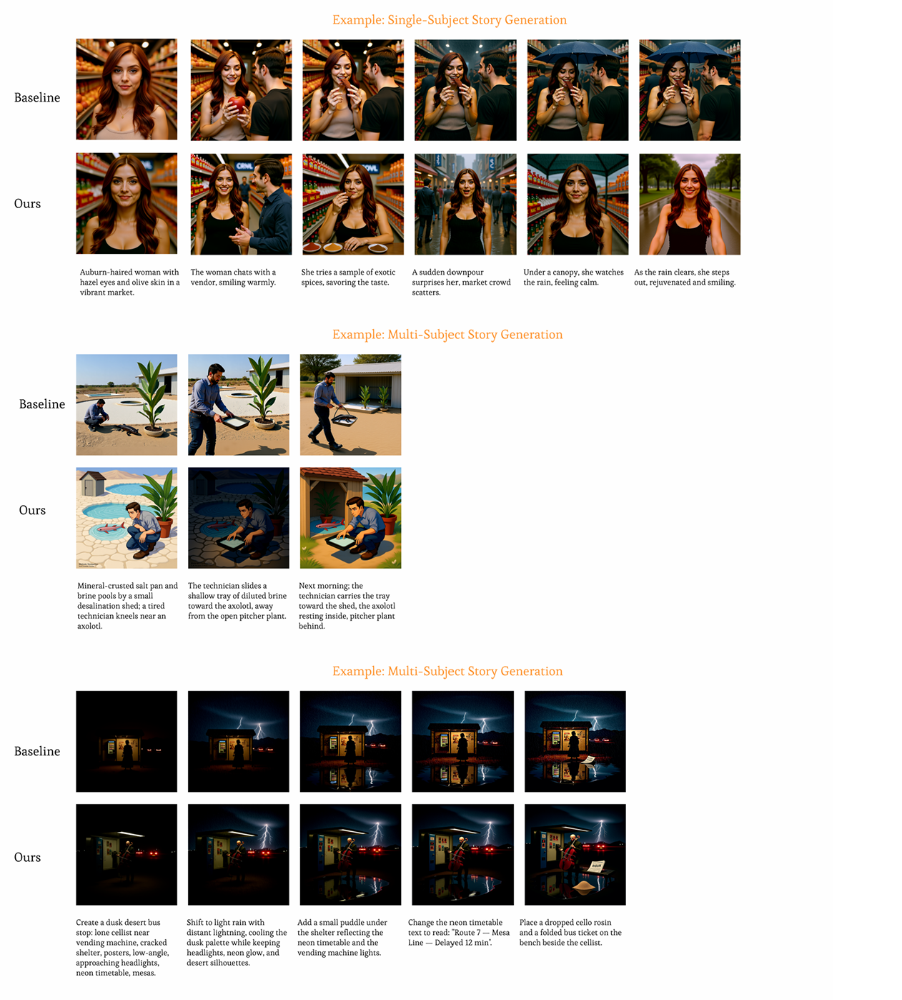
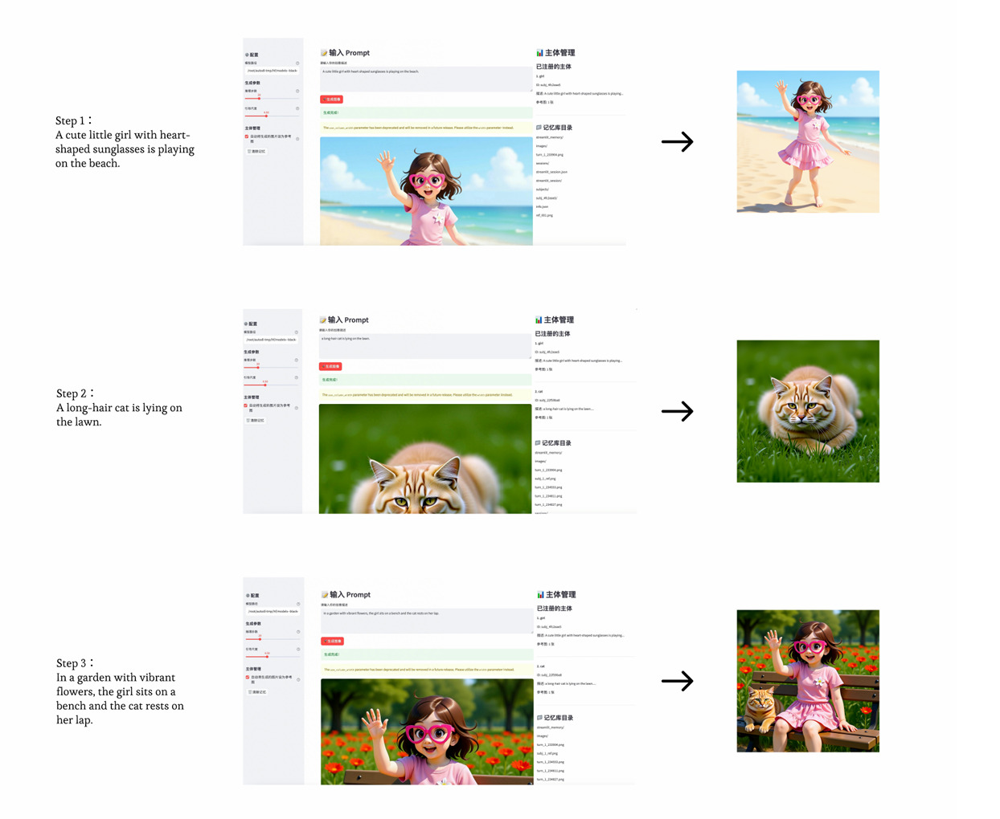
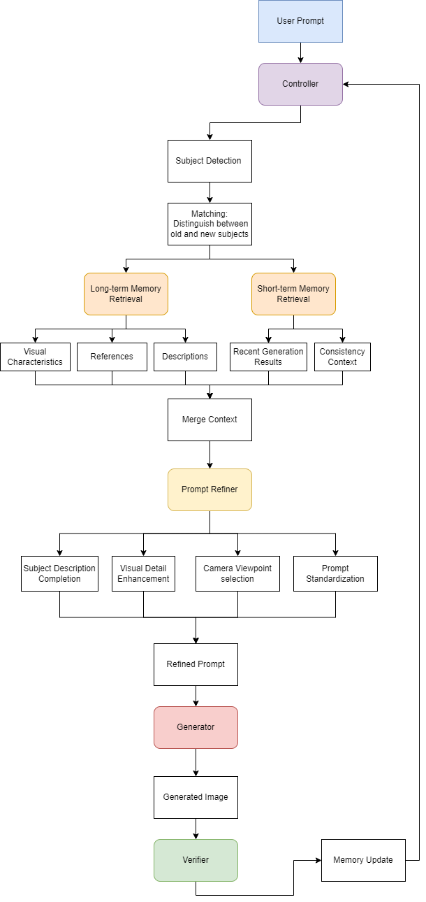

# Training-free Subject Consistency Enhancement for Long-form Story Generation

**Training-free subject consistency enhancement for multi-turn visual storytelling and image editing with FLUX.1 Kontext.**

This repository implements an inference-time agent framework that combines adaptive prompt refinement, memory-based subject retrieval, and generation verification to improve subject consistency across long sequences.

<table>
  <tr>
    <td align="center" width="50%">
      
      <br>
      <b>Long-form Generation</b>
      <br>
      <sub>Maintaining subject identity across multiple scenes.</sub>
    </td>
    <td align="center" width="50%">
      
      <br>
      <b>UI demo</b>
      <br>
      <sub>Integrating generation pipeline into user-friendly interactive interface. Supporting cross-turn subject reference. (The UI in this repo is a simplified version.)</sub>
    </td>
  </tr>
</table>

**Key Features**
- **Benchmark:** Evaluation pipelines for long-form visual storytelling and image editing.
- **Training-free Agent:** Adaptive prompt refinement, short- and long-term memory, subject retrieval, and generation verification.
- **Evaluation:** CLIP-I, DINO, and CLIP-T metrics for subject consistency and text-image alignment.
- **Interactive UI:** Multi-turn generation and editing with natural-language subject references.

> **Research Prototype:** This repository contains the core code and implementation of the proposed approach. Some environment-specific adjustments may be required, and results may vary across hardware setups and model configurations.

## Abstract

Visual storytelling and image editing require consistent subject identity across multi-turn image generation, yet systematic evaluation and effective consistency enhancement remain challenging. This thesis investigates these challenges using FLUX.1 Kontext. First, a benchmark is developed for long-sequence visual storytelling and image editing to evaluate subject consistency and text-image alignment. Second, a training-free enhancement workflow is proposed, integrating adaptive prompt refinement and memory mechanisms to improve consistency without modifying model parameters. Finally, an interactive agent framework is implemented to unify multi-turn image generation and editing in a user-friendly pipeline. Experimental results demonstrate improvements in subject consistency across long-sequence generation tasks, highlighting the potential of inference-time strategies for more coherent and controllable visual storytelling.


## Method overview




## Repository layout

```text
flux-kontext-consistent/
├── src/
│   ├── agent/                  # Agent modules and generation pipeline
│   ├── baseline/               # FLUX.1 Kontext baseline scripts
│   ├── benchmark_generation/   # Benchmark generators and quality filter
│   ├── metrics/                # Metric implementations and evaluation CLI
│   └── ui/                     # Streamlit interactive application
├── assets/                     # Figures displayed in this README
└── requirements.txt            
```

## Requirements and model setup

Install a matching PyTorch and torchvision pair for your operating system and CUDA setup using the [official PyTorch selector](https://pytorch.org/get-started/locally/). The listed minimums are PyTorch 2.6 and torchvision 0.21. Then install the project dependencies:

```bash
pip install -r requirements.txt
```

LLM-powered benchmark generation and Agent prompt refinement require `OPENAI_API_KEY` and `OPENAI_BASE_URL`. Configure both variables in your shell or create your own `.env` file in the repository root.  
FLUX.1 Kontext is a large model and CUDA is recommended. 

## Running the project

Under the `flux-kontext-consistent/` directory:

For baseline generation, Agent generation, and evaluation, model arguments accept either a Hugging Face model ID or a local model directory. If omitted, those commands use their default Hugging Face model IDs.

### Generate benchmarks


```bash
python src/benchmark_generation/generate_single.py
python src/benchmark_generation/generate_multi.py
python src/benchmark_generation/generate_edit.py
```

### Filter generated benchmark
```bash
python src/benchmark_generation/filter_benchmark.py --input <input_json> --output <output_json>
```
### Generate a baseline story

```bash
python src/baseline/generate_baseline.py --benchmark <input_json> --output-dir <output_dir> --model-id <hf_repo_id_or_local_path>
```

### Run the agent on a benchmark

```bash
python src/agent/main.py --benchmark <input_json> --output-dir <output_dir> --max-scenes 10 --model-id <flux_hf_repo_id_or_local_path> --clip-model <clip_hf_repo_id_or_local_path>
```

### Launch the interactive UI

```bash
streamlit run src/ui/app.py --server.address 0.0.0.0 --server.port 8501
```
Then open the Streamlit URL exposed by the local machine or server.

### Evaluate story-generation results

```bash
python src/metrics/evaluate.py \
  --task story \
  --benchmark <input_json> \
  --results-dir /path/to/results \
  --clip-model <clip_hf_repo_id_or_local_path> \
  --dino-model <dino_hf_repo_id_or_local_path> \
  --output metrics_results.json
```

### Evaluate image-editing results

```bash
python src/metrics/evaluate.py \
  --task edit \
  --benchmark <input_json> \
  --results-dir /path/to/edit_results \
  --clip-model <clip_hf_repo_id_or_local_path> \
  --dino-model <dino_hf_repo_id_or_local_path> \
  --sam3-model <sam3_hf_repo_id_or_local_path> \
  --save-masks-dir /path/to/evaluation_masks \
  --output edit_metrics_results.json
```

## Metrics

- **CLIP-I:** Cosine similarity between image embeddings; used across adjacent story frames and for image consistency in editing.
- **DINO:** Cosine similarity between DINOv2 image features for adjacent story frames.
- **CLIP-T:** Cosine similarity between an image and its instruction text.
- **Local edit metrics:** SAM3 segments the edited subject. Local CLIP-T is computed from the masked subject region; outside-mask CLIP-I measures consistency in the unedited region.

See `src/metrics/evaluate.py` for supported input structures, output fields, and local model path options.


## Limitations

- Subject extraction and natural-language reference resolution depend on LLM output and can fail for ambiguous pronouns, rare subject categories, or scenes with several interacting subjects.
- FLUX.1 Kontext remains the underlying generation-quality ceiling; the workflow does not train or fine-tune the base model.
- The current verifier uses CLIP-based scores as automatic signals. A passing score does not guarantee that every visual detail is correct.
- Local editing metrics depend on SAM3 returning a useful mask for the intended subject.

## Acknowledgements

We thank Black Forest Labs for **[FLUX.1 Kontext](https://github.com/black-forest-labs/flux/blob/main/model_cards/FLUX.1-kontext-dev.md)**, the image generation and editing model used in this project. We also acknowledge the research behind **[CLIP](https://arxiv.org/abs/2103.00020)**, used for image-text and image-image similarity; **[DINOv2](https://arxiv.org/abs/2304.07193)**, used to measure visual feature similarity; and **[Segment Anything Model 3 (SAM 3)](https://ai.meta.com/research/publications/sam-3-segment-anything-with-concepts/)**, used to segment target subjects for local editing metrics. The implementation uses the [Hugging Face Diffusers](https://github.com/huggingface/diffusers) and [Transformers](https://github.com/huggingface/transformers) libraries. We are grateful to the authors and maintainers for making these models, papers, and tools available.

